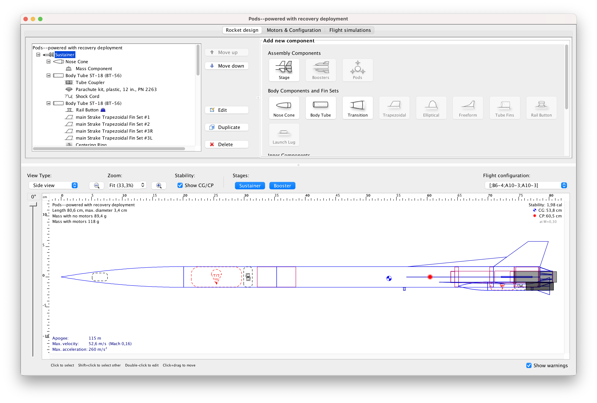
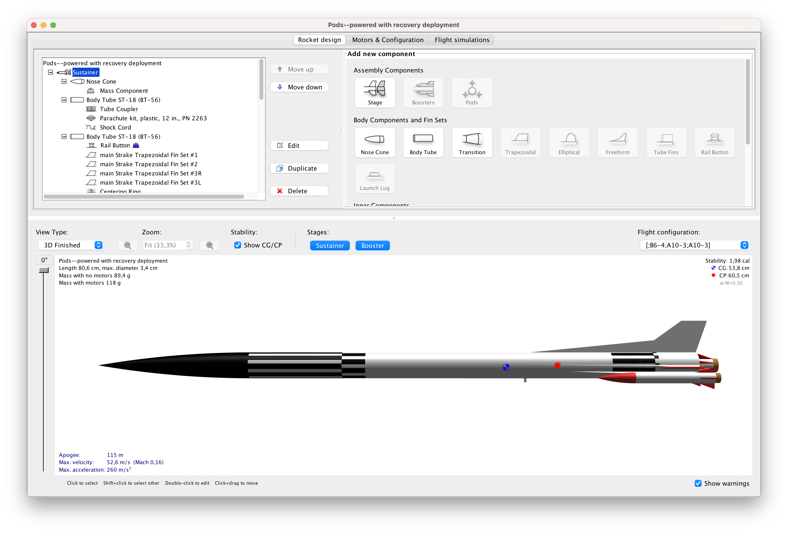
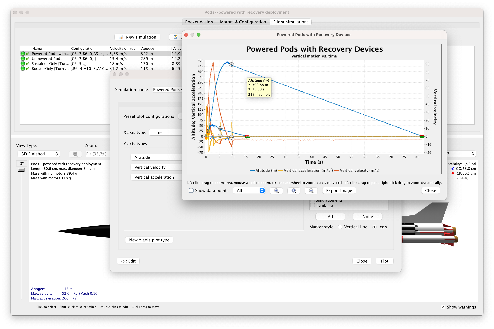
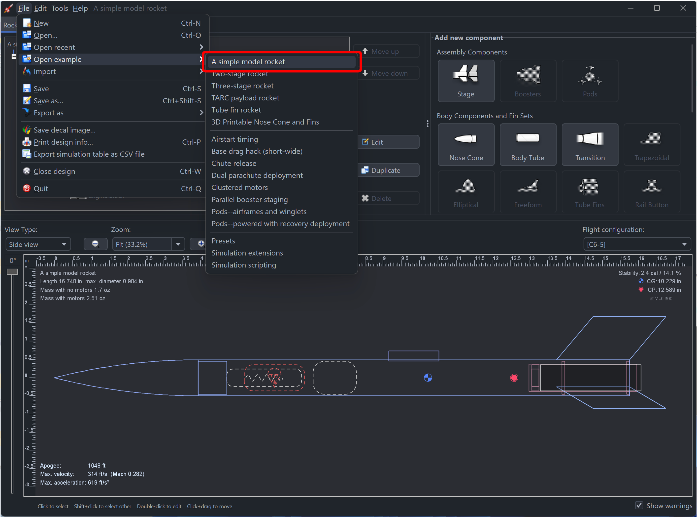

# Rocket Suite: OpenRocket with a RocketPy tab

> **This is a fork of OpenRocket 24.12 with one added tab: RocketPy.**
>
> Design the rocket in OpenRocket's own interface, then switch to the **RocketPy**
> tab to convert the design and fly it in [RocketPy](https://github.com/RocketPy-Team/RocketPy).
> Both engines stay in their current forms. OpenRocket owns the design (geometry,
> mass, centre of gravity, inertia, stability, thrust and drag curves); RocketPy
> owns the flight (atmosphere, gravity, forces, trajectory, events, apogee). Only
> design inputs cross between them, one way, and OpenRocket's own simulation
> results are never read by RocketPy - for the same flight configuration they
> agree: 50.1 m against 50.6 m for one motor, 319.9 m against 319.8 m for another.
>
> * `sidecar/` - the Python process that runs RocketPy, and its JSON protocol
> * `swing/src/main/java/info/openrocket/swing/gui/rocketpy/` - the tab itself
> * `PLAN.md` - stages, what has been measured, what is still open
>
> **Download and install (Windows):**
>
> **[RocketSuite-Setup.exe](https://github.com/DVVagram/rocket-suite/releases/latest/download/RocketSuite-Setup.exe)**
> - 297 MB, from [the latest release](https://github.com/DVVagram/rocket-suite/releases/latest).
>
> Double-click it. It installs for the current user - no administrator rights, no
> Java and no Python needed, because a linked Java 17 runtime and a Python with
> RocketPy are inside. It adds Start menu and desktop shortcuts and an entry in
> Apps and features, and takes 554 MB installed. The window opens in 9-11 s.
> The installer is unsigned, so SmartScreen will ask once: *More info* then
> *Run anyway*.
>
> To build it yourself instead: `packaging\windows\build.ps1` makes the portable
> folder and `RocketSuite-portable.zip` (unzip anywhere, run `RocketSuite.bat`),
> then `packaging\windows\make-installer.ps1` makes the installer from that zip.
>
> **Or run it from source** (JDK 17 and a Python 3.12 virtual environment):
>
> ```bash
> ./gradlew :swing:shadowJar
> java -cp swing/build/libs/swing-24.12-all.jar info.openrocket.swing.startup.OpenRocket
> ```
>
> The converter needs an OpenRocket 22/23 jar (24.12 renamed the packages it uses)
> and a JVM; see `sidecar/README.md` for the exact search order and how to set it.
>
> **macOS**: `packaging/macos/build-app.sh` links the same runtime, copies a
> standalone Python and the stack, and wraps it all in `RocketSuite.app` plus a
> `.dmg`. It has not been run yet - it was written on Windows - so the first Mac
> build is the test. The app is unsigned, so Gatekeeper will ask for a
> right-click > Open, or `xattr -dr com.apple.quarantine /Applications/RocketSuite.app`.
>
> Licensed GPL-3.0, as OpenRocket is. Everything below this line is the upstream
> OpenRocket README, unchanged.

---

# OpenRocket 🚀

OpenRocket is a free, fully featured model rocket simulator that allows you to design and simulate your rockets before actually building and flying them.


[](https://www.gnu.org/licenses/gpl-3.0)

[](https://GitHub.com/openrocket/openrocket/releases/)
[](https://openrocket.readthedocs.io/en/latest/)

[](https://snapcraft.io/openrocket)

[](https://discord.gg/qD2G5v2FAw)

--------

## 🛠️ Design, Visualize, and Analyze

1. **Design** your rockets using a rich selection of built-in components:
   

2. **Visualize** your masterpiece in 3D:
   

3. **Plot & Analyze** your simulation results for precision and improvements:
   

## 🌟 Features

- **Six-degree-of-freedom flight simulation**
- **Automatic design optimization**
- **Realtime simulated altitude, velocity, and acceleration display**
- **Staging and clustering support**
- **Export to other simulation programs (RockSim, RASAero II)**
- **Export component(s) to OBJ file for 3D printing**
- **Cross-platform (Java-based)**

... plus many more

📖 Read more on [our website](https://openrocket.info/).

## 💾 Installers

You can find the OpenRocket installers [here](https://openrocket.info/downloads.html).

Release notes are available on each [release's page](https://github.com/openrocket/openrocket/releases) or on [our website](https://openrocket.info/release_notes.html).

## 📖 Documentation

You can find our documentation on [ReadTheDocs](https://openrocket.readthedocs.io/en/latest/).

## 🚀 Getting started

**Check out [our documentation](https://openrocket.readthedocs.io/en/latest/setup/getting_started.html) for a detailled guide on how to get started.**

The easiest way to get familiar with OpenRocket is to open one of our in-program example designs:



Dive into the essentials: adjust component dimensions, plot a simulation, swap out motors, ... Explore the impact of your changes and, most importantly, enjoy the process! 😊

## 💪 Contribute

Help us soar higher! Whether it's implementing features, writing documentation, or creating design examples, every contribution matters. Interested? Check out [how to get involved](https://openrocket.info/contribute.html) and the [practicalities of contributing](CONTRIBUTING.md).

### ✨ Contributors
- [Sampo Niskanen](https://github.com/plaa) - Original developer
- [Doug Pedrick](https://github.com/rodinia814) - RockSim designs, printing
- [Kevin Ruland](https://github.com/kruland2607) - Android version
- [Bill Kuker](https://github.com/bkuker) - 3D visualization
- [Richard Graham](https://github.com/rdgraham) - Geodetic computations
- Jason Blood - Freeform fin set import
- [Boris du Reau](https://github.com/bdureau) - Internationalization
- [Daniel Williams](https://github.com/teyrana) - Pod support, maintainer
- [Joe Pfeiffer](https://github.com/JoePfeiffer) - Maintainer
- [Billy Olsen](https://github.com/wolsen) - Maintainer
- [Sibo Van Gool](https://github.com/SiboVG) - RASAero file format, 3D OBJ export, dark theme, maintainer
- [Neil Weinstock](https://github.com/neilweinstock) - Tester, icons, forum support
- [H. Craig Miller](https://github.com/hcraigmiller) - Tester

You can view the full list of contributors [here](https://github.com/openrocket/openrocket/graphs/contributors).

### 🌍Translators
- Tripoli France
- Tripoli Spain
- Stefan Lobas / ERIG
- Mauro Biasutti
- Sky Dart Team / Ruslan V. Uss
- Vladimir Beran
- Polish Rocketry Society / Łukasz & Alex Kazanski
- Sibo Van Gool
- Mohamed Amin Elkebsi
- Oleksandr Hladin

## 📜 License

OpenRocket is proudly open-source under the [GNU GPL](https://www.gnu.org/licenses/gpl-3.0.en.html) license. Feel free to use, study, and extend.

---
 
⭐ Please give us a star if you find OpenRocket useful, and spread the word! ⭐

[](https://star-history.com/#openrocket/openrocket&Date)
